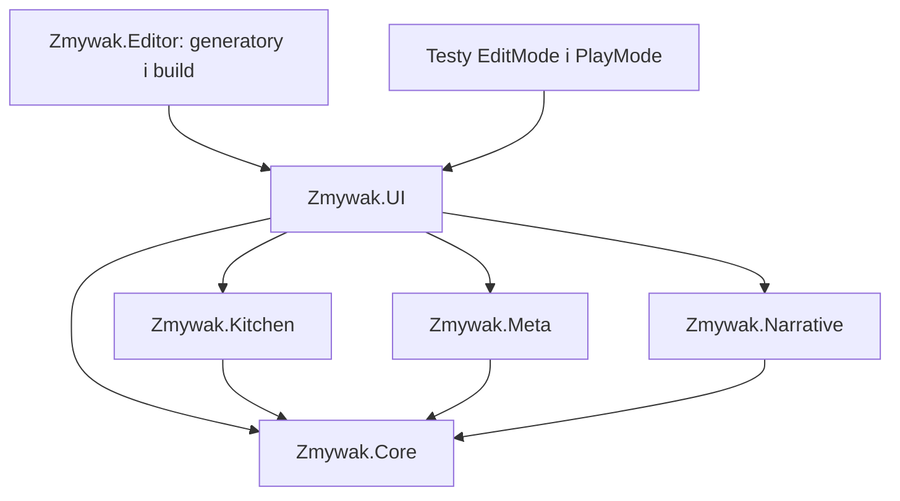

# ZMYWAK: Zielona Wyspa — opis i architektura

Audyt z 13.10.2026. Badany jest bieżący katalog roboczy, także pliki niezatwierdzone w Git, a nie sam HEAD. Ścieżki dowodów są względem katalogu projektu; numery linii dotyczą tej migawki. Oryginalne skrypty, sceny, ustawienia i assety nie były celowo zmieniane. Testy uruchomiono na odrębnej kopii poza repozytorium.

**Granica pewności:** analiza statyczna potwierdza strukturę i konkretne ścieżki wykonania, test automatyczny potwierdza tylko swoje asercje. Brak pomiarów telefonu, audytu słuchowego, ręcznego przejścia wszystkich wariantów fabuły i testów sklepowych oznacza UNKNOWN w tych obszarach. Nie deklarujemy poznania gry w 100%.

## Tożsamość i faktyczny zakres

Gra to jednoosobowy symulator pracy na zmywaku połączony z narracyjną symulacją życia polskiego emigranta. Bohater Kuba zaczyna w Dublinie 1 maja 2004 r.; kolejne rozdziały obejmują boom, kryzys i epilog w listopadzie 2010 r. Praca przy zlewie daje wypłatę i awanse; mieszkanie łączy wydatki, energię, tęsknotę, integrację i wybory fabularne. Nazwa katalogu „PowerWash Simulator” nie opisuje zawartości. Dowody: `README.md:1`, `Assets/_Project/Scripts/Meta/Progress/LifeLedger.cs:47`, `Assets/_Project/ScriptableObjects/Chapter_ch1.asset`–`Chapter_ch6.asset`.

Docelowo projekt jest mobilny, portretowy, Android first. Istnieją ustawienia i generator projektu iOS oraz osobny build Windows x64. Wersja produktu w ustawieniach to 1.0; nagłówek „Beta 1.0” w README jest deklaracją zespołu, nie wynikiem certyfikacji. Ocena audytu: rozbudowana implementacja o zakresie alfa / kandydat do zamkniętej bety, z niezamkniętymi warunkami stabilności i wydania. Szczegółowe bramki: `DEVELOPMENT_ROADMAP.md`.

## Konfiguracja

| Element | Zastany stan | Dowód / ograniczenie |
|---|---|---|
| Unity projektu | 6000.6.3f1, rewizja 45d8eee7de74 | `ProjectSettings/ProjectVersion.txt` |
| Unity dostępne lokalnie | 6000.6.5f1, rewizja 3ff58d469c8a | log nowego audytu; testy na kopii, różnica patcha |
| Rendering | URP 17.6.0, własny renderer, HDR, SRP Batcher; profile Low/Medium/High | manifest, GraphicsSettings, `Settings/Rendering/Zmywak_URP.asset`, QualityManager |
| Sterowanie | nowy Input System 1.20.0, Pointer (dotyk/mysz), Escape/back, opcjonalny sensor przechyłu | `activeInputHandler: 1`, DishInputRouter, DishController, KitchenPauseMenu |
| UI | uGUI 2.6.0 + TMP, Canvas i własne skrypty; 181 TextScaler w scenach gry | sceny i Zmywak.UI.asmdef |
| Android | IL2CPP, ARM64, min API 26, target SDK automatyczny (0), identyfikator com.zielonawyspagames.zmywak | ProjectSettings; nie jest to dowód zgodności przyszłej paczki ze sklepem |
| iOS | IL2CPP, eksport Xcode Development, natywna haptyka Objective-C++ | IosBuildScript, `Assets/Plugins/iOS/ZmywakHaptics.mm`; brak bieżącego testu urządzenia |
| Windows | okno 450×800, resizable, build script Mono | WindowsBuildScript; pomocniczy build, zakres wsparcia do decyzji |
| Zapis | JSON v2, 3 sloty, backup, migracje, osobne PlayerPrefs ustawień | SaveSystem, SaveData, SaveMigrations |
| Sieć | brak własnej gry sieciowej, serwera, zdalnego konta lub płatności | skan runtime; zainstalowane moduły Unity nie dowodzą implementacji |

## Pętla gracza

1. Menu: rozpoczęcie życia lub wybór jednego z trzech zapisów, ustawienia.
2. Mieszkanie: bieżąca scena fabularna, decyzje, telefon do mamy, odpoczynek, pub/kolacja/list, zakupy i przelew. Mapa uruchamia te same akcje; nie jest osobnym światem do chodzenia.
3. Zaplanowanie zmiany z kalendarza i opcjonalnego przygotowania na desce.
4. Kuchnia: wybór naczynia z fizycznego stosu, usunięcie resztek, płukanie, miejscowe szorowanie, ewentualne moczenie lub inspekcja szkła, układanie na stojaku i zmywarka. Równolegle zamówienia szefa, awarie, Flow i presja czasu.
5. Koniec zmiany: ocena, składniki wypłaty, rekordy i kariera. Kanał ShiftCompleted przenosi wynik do trwałej ekonomii; dzień idzie dalej.
6. Powrót do mieszkania, rachunki na granicy tygodnia i dalsza fabuła. Po epilogu pętla pracy może trwać dalej.

To pętla wynikająca z kodu i serializacji scen. Zakres potwierdzony bieżącymi testami jest opisany w `QA_STATUS.md`; nie zastępuje ręcznej gry na telefonie.

## Zawartość danych

- **35 grafów dialogów**, 274 węzły, 465 wpisów wypowiedzi, 95 opcji wyboru. Skan wykazał brak brakujących celów, duplikatów nodeId i strukturalnie nieosiągalnych węzłów. Osiągalność liczy wszystkie krawędzie niezależnie od flag, więc nie dowodzi osiągalności każdej gałęzi w prawdziwym zapisie.
- **6 rozdziałów:** Przyjazd; Pierwsza wypłata; Swoi i obcy; Celtycki Tygrys; Krach; Epilog: Listopad 2010. Rozdziały 1–5 po 6 beatów; epilog 5, z wariantami Dublin/Kraków/Pilbara. „Perth” w README jest uproszczeniem: aktualna klasa Place i mapa używają Pilbary.
- **8 definicji naczyń:** plate, pan, glass, bowl, mug, pot, roaster, lasagne_tray.
- **7 typów brudu:** baked_cheese, burnt_food, coffee, dried_porridge, dried_sauce, grease, streaks.
- **5 narzędzi w danych i pasku:** scraper, shower, soak, sponge, steel_wool. Narzędzie o ID `soak` oznacza także płyn do naczyń w istniejącej warstwie; osobne moczenie w zlewie ma własną logikę. Etykiety należy weryfikować według aktualnego UI, nie dawnych zrzutów.
- **5 archetypów zmian w katalogu:** calm_start, normal, lunch_rush, evening_rush, hard_night. Każda ma 180 s; normy bazowe odpowiednio 5/8/9/9/11. Dodatkowy `Shift_vertical_slice` to domyślna definicja sceny, nie szósty archetyp harmonogramu.
- **21 wpisów slangu**, 1 CharacterDefinition, tabela kursów i profile Volume. Postacie dialogowe dodatkowo używają identyfikatorów i mapowania portretów, dlatego jedna CharacterDefinition nie oznacza jednej postaci.
- 3 usterki małej zmywarki; 4 rodzaje zmian specjalnych; 5 rang kariery (0–4); 3 zakupy (materac, słownik, telefon); duża zmywarka: 40 naczyń i 30 minut czasu rzeczywistego.

Źródła: `Assets/_Project/ScriptableObjects`, `Resources/ShiftCatalog.asset`, MechanicUnlocks, SpecialShift, Career, LifeLedger, DishwasherRepair, BigDishwasherController.

## Wszystkie sceny

| Scena | Rola | GameObjecty zapisane | Build |
|---|---|---:|---|
| `Assets/_Project/Scenes/Boot.unity` | trwałe usługi, meta, fabuła, jakość, grading | 2 | 0 |
| `Assets/_Project/Scenes/MainMenu.unity` | menu, sloty i ustawienia, pokój jako tło | 240 | 1 |
| `Assets/_Project/Scenes/MetaHub.unity` | ekonomia, dialogi, mapa, sklep, historia | 307 | 2 |
| `Assets/_Project/Scenes/Kitchen_Shift.unity` | pełna kuchnia, HUD, tutorial, wynik | 683 | 3 |
| `Assets/InitTestScene5bbb867d-1bdf-481d-9d60-baafdb45d2e4.unity` | techniczna scena runnera, 1 GO | 1 | nie |
| `Assets/InitTestScenec265bff9-1de5-48c6-b355-6f62c552df41.unity` | techniczna scena runnera, 1 GO | 1 | nie |
| `Assets/InitTestScenecc052ef6-1c0b-4e74-8d3e-a595dc3ad8e6.unity` | techniczna scena runnera, 1 GO | 1 | nie |
| `Assets/_Recovery/0.unity` | scena odzyskiwania, bez GO | 0 | nie |

Liczby to obiekty serializowane, nie runtime ani draw calls. Przykładowo naczynia, dźwięk i część UI powstają dopiero w trakcie gry. Nie ma plików `.prefab`, `.controller`, `.anim` ani `.inputactions` w Assets. Brak prefabów jest świadomym sposobem generowania zawartości, nie awarią.

## Architektura i zależności

To uproszczenie głównych zależności; dokładny graf assembly wynika z ośmiu `.asmdef` (5 runtime, Editor, 2 testowe). Core zależy od URP, Kitchen od Input System, UI od TMP/uGUI/Input/URP. UI jest warstwą integracji ekonomii, fabuły i kuchni. Kitchen otrzymuje kondycję gracza przez IPlayerCondition. Nie wykryto cyklu między pięcioma własnymi modułami runtime.

Boot utrzymuje GameStateMachine, MetaProgressController, NarrativeProgressController i QualityManager przez DontDestroyOnLoad. ServiceLocator to globalny rejestr, bez wymuszania unikalności instancji. State Enter uruchamia SceneLoader; powtórne wejścia do slotu usuwają obiekty gry i odtwarzają Boot przez StartFromAnyScene. GameAudio, SceneLoader i LoadingScreen używają trwałego cyklu życia / IKeepAcrossRestart. UiBootstrap dokłada UI sounds i ambience do scen; brak tych komponentów w YAML jest oczekiwany.

ShiftController spina timery, generator naczyń, harmonogram, stos, szefa i zmywarki. DishController łączy input, fizykę, maskę, renderer i FX, a DishInstance/DirtCanvas przechowują model mycia. LifeLedger to model życia, MetaProgressController zapisuje zmiany. DialogueSession interpretuje graf, DialogueRunner przekazuje zdarzenia, StoryBeatTrigger łączy nagrody z LifeLedger.

Zapis jest współdzielonym plikiem: meta, narracja, tutorial i duża zmywarka robią odczyt → modyfikację własnych pól → zapis. Nie wykryto równoległego pisania tego pliku z Task.Run; najważniejsze ryzyko to wiele osobnych zapisów jednej operacji fabularnej, a nie udowodniony wyścig dwóch wątków. DirtPrewarm używa pracownika do danych maski i ma synchroniczny fallback.

## Katalogi i liczby

| Katalog | Znaczenie |
|---|---|
| `Assets/_Project/Scripts` | 159 plików C#, 26 794 linie; pięć modułów gry |
| `Assets/_Project/Editor` | 25 plików C#; sceny, art, fabuła, bake i build |
| `Assets/Tests/EditMode`, `PlayMode` | odpowiednio 52 i 27 plików C#, w tym helpery |
| `Assets/_Project/Art`, `Audio`, `Shaders` | proceduralne i wygenerowane zasoby, nagrane/baked audio, własne shadery |
| `Assets/_Project/Resources` | sześć assetów ładowanych po nazwie lub zależnościach |
| `Assets/_Project/ScriptableObjects`, `Settings` | dane balansowe/fabularne i rendering |
| `Assets/TextMesh Pro`, `Assets/Plugins/iOS` | zasoby tekstowe i natywna haptyka |
| `Tools/Blender` | generatory portretów/rekwizytów, źródła `.blend`, podglądy i walidacja |
| `Tools/*.ps1`, `.github/workflows` | build Android i pomiary telefonu, workflow CI |
| `Packages`, `ProjectSettings` | pakiety i konfiguracja Unity |
| `Library`, `Logs`, `Builds`, `build`, `.utmp`, `UserSettings` | cache, logi, artefakty i lokalne dane; nie równoważne źródłom gry |

Skan Assets: 1642 pliki, w tym 861 `.meta`, 263 C#, 218 `.asset`, 77 materiałów, 86 PNG, 66 WAV, 12 EXR, 2 cubemapy i 2 `.lighting`. Rozmiar plików Assets około 54,2 MiB; to nie rozmiar builda ani pamięć procesu. Źródła C# z testami i narzędziami Editor: 54 664 linie. Nie znaleziono duplikatów GUID ani plików będących niewczytanymi wskaźnikami LFS w Assets.

## Pakiety zewnętrzne

Bezpośrednie: Input System 1.20.0, Localization 1.5.13, URP 17.6.0, Test Framework 1.8.0, uGUI 2.6.0 oraz moduły Unity. Lockfile zawiera m.in. Addressables 2.11.2, Collections 6.6.0, Burst 2.0.0, ShaderGraph/Core RP 17.6.0, Newtonsoft JSON 3.2.2, Scriptable Build Pipeline 3.0.3 i Performance Test Framework 6.6.0. Obecność pakietów Localization/Addressables nie dowodzi użycia ich systemów: nie znaleziono własnych wywołań ani katalogów adresowalnych / tabel lokalizacji. Teksty są w kodzie i grafach, a resource loader używa Resources.Load. Bez usuwania pakietów w tym audycie.

## Uruchamianie i budowanie

Zwykła praca: otworzyć projekt właściwą wersją Unity, uruchomić Boot. StartFromAnyScene przekierowuje bezpośredni start menu/huba/kuchni przez Boot. W audycie oryginalnego projektu nie otwierano w Editorze. `Zmywak/Setup/Run All (1-8)` przebudowuje źródłową zawartość/sceny/konfigurację, więc nie należy używać go jako neutralnego kroku testowego.

Punkty wejścia buildów: `Zmywak.EditorTools.WindowsBuildScript.BuildWindows`, `Zmywak.EditorTools.AndroidBuildScript.BuildAndroid`, `Zmywak.EditorTools.IosBuildScript.BuildXcodeProject`. BuildPreflight sprawdza sceny i input. Android ma skrypt PowerShell oraz CI; iOS eksportuje Xcode Development, nie gotową podpisaną aplikację. Budowanie może modyfikować ustawienia i cache, dlatego nie wykonywano nowego builda na oryginale.

Istnieje APK `Builds/Android/Zmywak-dev.apk` (46 240 586 bajtów) i build Windows. Archiwalny log Androida kończy się sukcesem, lecz nie wiąże APK z bieżącym kodem. Daty plików synchronizowanych przez OneDrive nie są dowodem rewizji. Każdy kolejny kandydat powinien otrzymać manifest kodu, wersji silnika, pakietów, konfiguracji i hash paczki.

## Wizja a realizacja

Wizja: satysfakcja z ręcznego mycia ma finansować i kontrastować z trudnymi wyborami emigracyjnymi. Implementacja zawiera te powiązania, nie tylko osobne sceny. Docelowe odczucie pracy, równowaga presji i relaksu, wartość replayability oraz jakość audio wymagają badań z graczami. Nie ma dowodu potrzeby pojazdów, walki, AI przeciwników, wyścigów ani multiplayera; nie są brakami wobec odtworzonej koncepcji.
